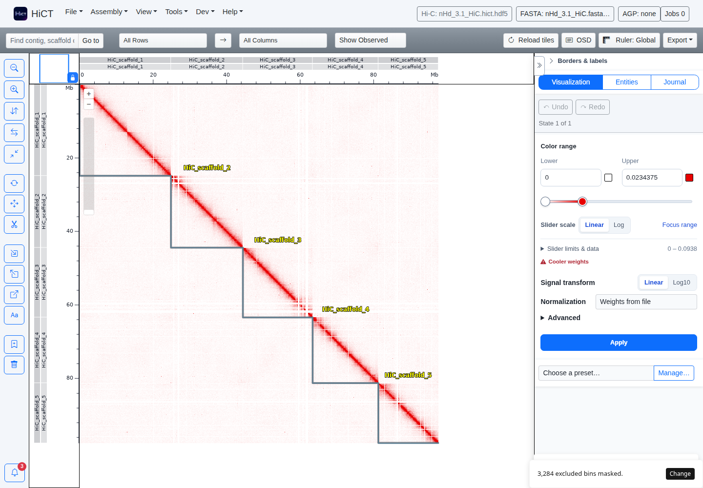

= HiCT
:toc:
:toclevels: 2

HiCT is a desktop and browser workstation for inspecting Hi-C contact maps and
curating genome assemblies. Select, reverse, move, split and group sequence,
inspect linked FASTA and annotations, compare matrix layers, and export an
assembly or publication figure. Assembly edits support Undo and Redo.

The JVM server stores and edits matrices. The Vue WebUI provides the interface.
Portable packages include Java and the native tools needed for conversion,
sequence search and dotplots. Data remain in the directory you choose.

== Install a portable package

Download the asset for your architecture from the
https://github.com/ctlab/HiCT_JVM/releases[release page]. Verify its SHA-256
against the accompanying checksum file. The release validation report records
which artifacts have completed platform checks.

=== Linux x86-64

Use `HiCT-<version>-linux-x86_64.run` on a supported glibc distribution.
The launcher extracts into its cache and opens the Launcher window.

[source,bash]
----
chmod +x HiCT-<version>-linux-x86_64.run
./HiCT-<version>-linux-x86_64.run
----

The `HiCT-<version>-x86_64.AppImage` asset offers another packaged runtime.
Make it executable and start it. For a FUSE mount failure, use its extraction mode.

[source,bash]
----
chmod +x HiCT-<version>-x86_64.AppImage
APPIMAGE_EXTRACT_AND_RUN=1 ./HiCT-<version>-x86_64.AppImage
----

=== Windows x86-64

Run `HiCT-<version>-windows-x86_64.exe`, choose a data folder and press Start.
The portable ZIP can also be extracted into a writable folder and started with
`HiCT.cmd`. Organization policies may require approval for an unsigned executable.

=== macOS

Choose `darwin-arm64` for Apple Silicon or `darwin-x86_64` for Intel. The `.run`
asset extracts its portable application. In Terminal, run the matching file.
Review any macOS security prompt using your organization's software policy.

[source,bash]
----
chmod +x HiCT-<version>-darwin-arm64.run
./HiCT-<version>-darwin-arm64.run
----

=== Start with your own data folder

The Launcher lets you select the data directory. In server mode, set `DATA_DIR`.
The browser interface uses port 8080 and its API uses port 5000 by default.

[source,bash]
----
mkdir -p "$HOME/hict-data"
DATA_DIR="$HOME/hict-data" HICT_BIND_HOST=127.0.0.1 \
  ./HiCT-<version>-linux-x86_64.run start-server
----

Open `http://localhost:8080`. Existing files under `DATA_DIR` appear in the file
picker. Generated files and downloaded examples also live there. Set
`PROCESSED_DIR` separately when you want conversion scratch on another disk.

== Five-minute quick start

. Start HiCT with a writable data directory and open its browser interface.
. Choose *Help → Examples…* and press *Open example* on *Tardigrade quick start*.
  HiCT downloads about 45 MB, converts the contact map and links the matching
  FASTA. This path takes three clicks from the initial page. It completed in
  20.3 seconds in the recorded Linux browser test. Network and hardware affect timing.
. Use the mouse wheel to zoom and drag the map to pan. Click a contig or
  Shift-drag a range. Press Reverse, then Undo to restore it.
. Choose *File → Save session…*. A session retains assembly edits, visualization,
  linked inputs and the view. Keep the referenced data files available.
. Export an AGP layout or FASTA through *Assembly*. Use *Export* above the map
  for PNG, SVG or PDF. FASTA exports require a linked reference.

The catalog includes larger cheetah and mosquito examples. Each records source
URLs, checksums, citations and provider terms. Their complete downloads and
conversions take longer. See link:docs/examples-catalog.md[example validation].

== Inputs and outputs

[cols="1,3",options="header"]
|===
|Format |Use
|`.hict.hdf5` |Native editable matrix storage, direct opening
|`.cool`, `.mcool`, `.hic` |Import through the bundled converter with resolution and normalization options
|FASTA, gzip FASTA |Linked reference sequence or FASTA-only assembly
|AGP, `.assembly` |Assembly layouts subject to reference compatibility checks
|BED, bedGraph, GFF, GTF, BigWig |Signal and annotation tracks
|Session JSON |Restore edited assembly, inputs, settings and view, including split lineage
|AGP, FASTA |Export the curated assembly
|PNG, SVG, PDF |Visible viewport or fitted whole-map figures
|===

The file picker opens a native map directly. *Open with options…* provides the
conversion wizard. A secondary matrix may use a different resolution pyramid
when its reference coordinates agree. The primary assembly grid governs display.
At letter zoom, linked sequence and bounded exact alignments follow the edited
assembly coordinates. Whole-map figure exports use their fitted scale.

== System requirements and storage

Use a 64-bit desktop with a recent browser. Source builds require JDK 21 and
Node.js. Portable packages contain their own Java runtime. An 8 GiB machine
provides a practical starting point for the bundled examples. Larger matrices,
parallel tools and browsers require more memory and disk.

Portable launchers set Java's `MaxRAMPercentage` to 50. On an 8 GiB host this
provides a 4 GiB Java heap. Set `HICT_JAVA_OPTS=-Xmx6g` to choose an explicit limit
for a suitable host. Native tools and the browser use additional memory.

Keep free disk for source downloads, the generated matrix, native conversion
scratch and the uncompressed FASTA index. The recorded cheetah trial used about
5.93 GB for final data and its FASTA index, and its sampled Java peak was 2.59 GB.
See the example validation document for exact measurements and sampling limits.

== Remote server over SSH

The default services bind to all interfaces and accept browser requests through
permissive CORS. They expose file access and assembly mutation without an
authentication layer. Restrict access to trusted users. Set `HICT_BIND_HOST` to
loopback and forward both ports over SSH.

On your local workstation, connect with port forwarding.

[source,bash]
----
ssh -L 8080:127.0.0.1:8080 -L 5000:127.0.0.1:5000 user@cluster.example.org
----

In that SSH session, start the remote package.

[source,bash]
----
DATA_DIR=/path/to/data HICT_BIND_HOST=127.0.0.1 \
  ./HiCT-<version>-linux-x86_64.run start-server
----

Open `http://localhost:8080` locally. Keep the SSH session running.
Use `VXPORT` and `WEBUI_PORT` when the default server ports are occupied, and
configure the corresponding API address in the WebUI. Stop the server before
removing its data or scratch directories.

== Guide and API

* link:docs/user-guide.md[User guide and keyboard shortcuts]
* link:docs/jvm_api_v1.md[API guide]
* `http://localhost:5000/api/v1/` serves the bundled offline API reference.
* link:docs/normalization.md[Normalization] describes square-root coverage over
  one whole-map domain and the treatment of excluded bins.
* link:docs/reinforcement-validation.md[Validation evidence] and
  link:docs/release-manual-checklist.md[platform checklist] record release gates.

== Current limits

Sessions reference their input files and validate those files on restore. Undo
history belongs to the running editing session. FASTA-only assemblies have no
contact signal. Split removes a finest-resolution bin, and Undo restores it.
Alignment detail has bounded intervals and work limits. Secondary matrices need
matching reference intervals. Native tools have platform-specific payloads.
Windows and macOS qualification includes the platform CI results and the owner's
manual checklist. Consult the release validation report for their current status.

== Build from source

Clone `HiCT_JVM` and `HiCT_WebUI` side by side. Build and test the packaged WebUI
and JVM together with the normal Gradle entry point.

[source,bash]
----
./gradlew test shadowJar
java -jar build/libs/hict_server-<version>-fat.jar start-server
----

During JVM-only development, `./gradlew test -x copyWebUI` reuses the existing
WebUI resources. Packaging uses the normal bundled-WebUI build.

== Citation and attribution

Cite the software version and repository revision used in your analysis.
The machine-readable author list and software citation are in
link:CITATION.cff[CITATION.cff]. Also cite the dataset provider and native analysis
tools used for your results. The Examples dialog preserves dataset citations.

HiCT is distributed under the link:LICENSE[MIT License]. Bundled components
retain their own terms. See link:THIRD_PARTY_LICENSES.md[third-party notices],
the package `licenses/`, Java `runtime/legal/` and toolchain `share/licenses/`.
